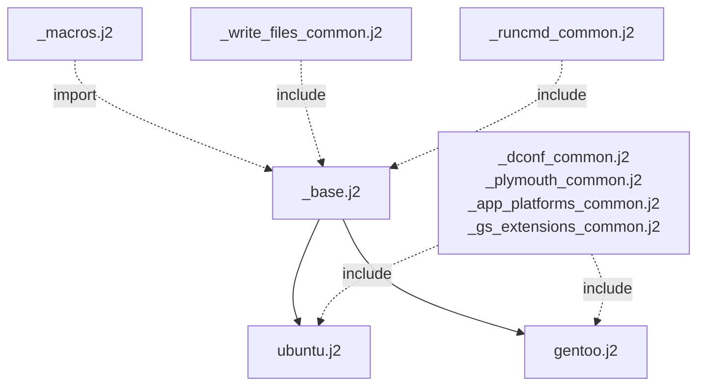

# linux-desktop-vm — Architecture & Fleet Guide

This document covers the internal architecture, build phases, pre-flight
gates, timing data, and fleet-building orchestration. It's intended for
developers and maintainers — end users should start with [README.md](../README.md).

## Template hierarchy



Solid arrows are ``. `_base.j2` imports `verify_gate_apt`
from `_macros.j2` and includes the shared `write_files` / `runcmd`
partials; both concrete templates include the four `_*_common.j2`
desktop partials in their `runcmd`. `ubuntu.j2` owns the full APT stack
(inlined from the retired `_apt_family.j2`).

## Latest-Version Discovery

Each distro's "latest" is resolved at runtime, not hardcoded:

| Distro | Source of truth |
|--------|----------------|
| Ubuntu LTS | `changelogs.ubuntu.com/meta-release-lts`: highest LTS wins, then a HEAD check of `cloud-images.ubuntu.com/<codename>/current/<codename>-server-cloudimg-arm64.img` (403/404 falls back to the next-highest LTS); hash from that dir's `SHA256SUMS` |
| Gentoo | `distfiles.gentoo.org` autobuilds index (latest `di-<arch>-cloudinit-*.qcow2`) |

When a new release ships (Ubuntu 28.04 LTS, etc.), the script
picks it up automatically with no code change.

## How It Works (internal flow)

1. Refuse an existing `disk.qcow2` unless `--force` is passed and no QEMU is running for that target dir (exit 8, checked before any download).
2. Detect host (macOS on arm64) and locate a **virgl-enabled** `qemu-system-aarch64`, probing `~/VMs/qemu-system-aarch64-gl`, `/opt/homebrew/opt/qemu-virgl/bin`, then `/opt/homebrew/bin` (and `/usr/local`, `/opt/local`). A missing or non-virgl QEMU is a hard error (exit 3). OVMF firmware is found relative to the binary first; firmware from a different package-manager prefix is rejected.
3. Find qemu-virgl's `qemu-img` (`/opt/homebrew/opt/qemu-virgl/bin`, then next to the detected virgl `qemu-system-aarch64`, then `PATH` only if it resolves into a `Cellar/qemu-virgl` keg). Stock Homebrew `qemu` is never installed or used; if none is found, exit 4 with the `qemu-virgl` install hint.
4. Check that `pycdlib`, `certifi` and `jinja2` import. Nothing is installed: a missing one is exit 5, so run from the project `.venv` (`pip install -r requirements.txt`).
5. Resolve the chosen distro's latest cloud image URL + hash.
6. Download + verify the cloud image (SHA256 for both distros) via the shared cache.
7. Extract a `.tar.xz` image if needed, `qemu-img convert -O qcow2` into `disk.qcow2.building`, `qemu-img resize` it to the target size, then atomically rename it to `disk.qcow2`.
8. Render cloud-init templates with hostname / username / password / TZ.
9. Build a NoCloud seed ISO (volume label `cidata`) using `pycdlib`.
10. Render the VM definition file (shell launcher script).
11. With `--start` only (default is build-only; the fleet always passes it): launch the launcher detached, stderr to `qemu-stderr.log`, and watch it for 3 s so an early QEMU abort fails the build.

Inside the guest, cloud-init then:
- Sets hostname, creates the user with sudo, sets the password
- Updates packages and installs the desktop (distro-specific install path)
- Sets `graphical.target` as default and starts GDM (`systemctl enable --now`) on the same boot (Wayland session)
- Does **not** reboot: `power_state` is deliberately omitted from `_base.j2`. The fleet powers the VM off over SSH after `VERIFY-OK`.

## Code Organization

The orchestration lives in `linux_vm/` (see [AGENTS.md](../AGENTS.md)'s repository layout).
`_build_one_vm()` in `linux_vm/orchestrate.py` delegates to
single-responsibility helpers:

1. **`find_qemu_img(host, qemu_system)`** (`host.py`) - Locate qemu-virgl's qemu-img (opt keg, then next to the virgl `qemu-system`, then `PATH` only inside a `Cellar/qemu-virgl` keg); never installs or accepts stock `qemu`
2. **`_install_if_missing(installer_func, package_name)`** - Runs an `ensure_pycdlib` / `ensure_certifi` / `ensure_jinja2` check and only logs a missing dependency (the checks raise `RuntimeError`; nothing is installed)
3. **`_build_vm_config(args, host, defaults, resolved)`** - Build and configure VM configuration with distro-specific VM name logic (uses the already-resolved distro object; resolve happens once before config)
4. **`_ensure_image(resolved, qcow2, cache_dir, distro)`** - Download, hash verification, and cache management. The shared-cache path (`download_to_cache`) verifies the hash once on the cached file; a hardlink into the target dir shares that inode so it is not re-hashed, while a real cross-volume copy gets its own verification. A stale target image is detected by the reuse-path hash check and re-downloaded.

`_build_one_vm()` runs these in four phases: QEMU detection, host-side
preparation, image resolution/caching, and launch (template rendering +
VM startup).

## GPU & display

### Launcher argv (`linux_vm/qemu.py: _build_qemu_argv`)

The generated launcher `exec`s one `qemu-system-aarch64` with:

- `-machine virt,accel=hvf:tcg,kernel-irqchip=off` (this QEMU hangs EDK2
  boot under HVF with the in-kernel vGIC) and `-cpu host`, falling back
  to `max` when a probe shows `host` is rejected (TCG).
- Disk and NoCloud seed both as `virtio-blk-pci` (a USB seed enumerates
  too late for cloud-init's `ds-identify`).
- User-mode `virtio-net-pci` with a **loopback-only** SSH forward
  `hostfwd=tcp:127.0.0.1:<port>-:22`; unless `--ssh-port` is given, the
  launcher picks the first free port in 2222-2321 at launch time. The
  guest is never reachable from
  the LAN. That is why the predictable default credentials are acceptable.
- GPU: probe `virtio-vga-gl`, else `virtio-gpu-gl-pci`, then probe
  `-display cocoa,gl=es`. If the cocoa GL probe fails, fall back to a
  non-GL `virtio-vga` / `virtio-gpu-pci` with plain `-display cocoa`
  (guest gets `llvmpipe`). When the GL device has a `venus` property it
  becomes `<dev>,venus=on,blob=on,hostmem=4G` with `-vga none`, and guest
  RAM is backed by `-object memory-backend-ram,id=mem1` (wired via
  `-machine …,memory-backend=mem1`) so blob resources can be mapped.
- `virtio-sound-pci,streams=2` on a `coreaudio` audiodev (playback + capture
  from the macOS default input device; capture needs `qemu-virgl` from the
  fork with CoreAudio input (November 2026+), and macOS mic permission for the app that launched
  QEMU — otherwise the guest mic records silence).
- `qemu-xhci` with `usb-kbd` + `usb-tablet`.
- Serial console to `<target_dir>/console.log`, `virtio-serial-pci`, and
  a SPICE vdagent channel when the build supports `spicevmc`.
- EDK2 pflash: read-only code + a per-VM writable copy `nvram.fd`.

Before `exec` the launcher exports `DYLD_LIBRARY_PATH=/opt/homebrew/lib…`
(libepoxy `dlopen`s ANGLE's `libEGL.dylib`; set in the script because
macOS strips `DYLD_*` across `/bin/sh`) and points both `VK_DRIVER_FILES`
and its deprecated alias `VK_ICD_FILENAMES` at the host Vulkan ICD
(MoltenVK, or KosmicKrisp with `--host-vulkan-driver kosmickrisp`).

### Host stack (Homebrew tap `milesbuckton/qemu-virgl`)

Source: `~/Developer/homebrew-qemu-virgl`. All formulas are keg-only so
they never shadow core `qemu` / `virglrenderer`.

| Formula | Builds | Notes |
|---|---|---|
| `qemu-virgl` | `gitlab.com/milesbuckton/qemu` `master`, `--target-list=aarch64-softmmu`, `--enable-cocoa --enable-opengl --enable-virglrenderer` | depends on `libangle`, `libepoxy-angle`, `virglrenderer` |
| `virglrenderer` | `gitlab.freedesktop.org/miles.buckton/virglrenderer` `main`, `-Dvenus=true` | depends on `molten-vk`, `vulkan-loader`; `kosmickrisp` on macOS 26+ |
| `libangle`, `libepoxy-angle` | ANGLE (GLES over Metal) and a libepoxy built against it | |
| `kosmickrisp` | `miles.buckton/mesa` `main` KosmicKrisp Vulkan ICD | macOS 26+ only; used only when selected; bottled on `arm64_golden_gate` (macOS 27), source build elsewhere |

Bottles (`arm64_golden_gate`) are uploaded to the rolling `latest`
GitHub release by the manually triggered `publish.yml` workflow.

The QEMU fork carries one commit on top of upstream: Cocoa GL scanout via
ANGLE/EGL (`gl=es` only; `gl=core` is rejected), HVF skipping
non-host-page-aligned memory sections, and a `blob-alignment` property
that offers `VIRTIO_GPU_F_BLOB_ALIGNMENT` with the host page size.

### Guest side and checks

Both templates build the `miles.buckton/mesa` fork (`main`) in the guest
with `-Dgallium-drivers=virgl,llvmpipe -Dvulkan-drivers=swrast,virtio`,
so virgl/Venus are used when present and llvmpipe/lavapipe remain as
fallback. `scripts/check-virgl.sh <vmdir>` and `scripts/check-venus.sh
<vmdir>` run on the host and SSH into a booted VM to verify that GL
renders through virgl and Vulkan through Venus.

### Related host-side details

- **GNOME extension server**: the fleet serves cached extension zips
  from a `python -m http.server` bound to `127.0.0.1`; the guest reaches
  it as `http://10.0.2.2:<port>` (slirp's host alias), passed to
  `setup_vm.py` as `--gnome-ext-url` (anything else is rejected).
- **Per-VM SSH key**: `setup_vm.py` generates an ed25519 `ssh_key` in the
  target dir for monitor/fleet SSH; it and `install-info.txt` are 0600.
- **venv re-exec**: the gate scripts re-exec into the repo's `.venv`
  (`linux_vm/venv_bootstrap.py`) so they always have their dependencies.

## Pre-flight gates

The fleet orchestrator runs seven cheap-to-expensive gates (0, 0b, 0c,
0d, 1, 2, 3) that catch
failures fast instead of discovering a typo in a 6-hour fleet run. Gates
0, 0b, 0c and 0d are the seconds-scale static checks; 1 through 3 grow
from minutes to a quarter of an hour.

### Gate 0 — Lint (~3 sec)

`python scripts/lint-templates.py` renders every (distro ×
mode) combo via jinja2, validates the YAML, and asserts every render
contains the `VERIFY-OK` / `SIMULATE-OK` markers. Currently 16/16 pass
(2 distros × 2 arches × 4 checks: real, simulate, package parity, and
password quoting).

The per-render checks are:

- **Render + YAML** — jinja2 render, `yaml.safe_load`, required top-level
  keys, and marker presence: `VERIFY-OK` plus `VERIFY-FAIL` in real mode,
  `SIMULATE-OK` plus `SIMULATE-FAIL` in simulate mode, so a failure is
  always loud. `templates/network-config.j2` is also parsed as standalone
  YAML.
- **Shell syntax** — `sh -n` and `bash -n` on every `runcmd`/`bootcmd`
  entry that hands a script to a shell, and on every `write_files`
  payload whose path ends in `.sh` (e.g. `gentoo-install.sh`). Matched
  via `entry[1] == "-c"` historically, which silently skipped `bash -lc`
  entries; the shared `linux_vm/audit.py` matcher now recognises a known
  shell binary (`sh`, `bash`, `dash`, `zsh`, `ksh`, `mksh`, `ash`) plus
  flags from `-c`/`-lc`/`-cl`/`-ic`/`-i`/`-l`, so both gates agree on
  what a shell entry is.
- **Simulate/real parity** — the packages installed by the real install
  script must match the simulate-mode package list, or the dry-run is
  validating something the real build never installs.
- **Password quoting** — re-renders each template with hostile password
  shapes (`1234`, `yes`, `0000`, `true`, `it's-a-quote`, `say "hi"`,
  `a:b`) and checks every password-bearing key (`plain_text_passwd`,
  `passwd`, `password`, `hashed_passwd`, …, matched by key name, not by
  value) in the resulting cloud-config, failing unless the value parsed
  as a `str` equal to the exact password. This
  is the gate that catches an unquoted `password: {{ PASSWORD }}`, which
  renders `1234` as an int and `yes` as a bool and makes cloud-init
  reject the whole user-data. It fails on all four (distro × arch) combos
  if `_base.j2` ever loses its `'{{ PASSWORD | replace("'", "''") }}'`.

The fleet runner executes this itself as its first gate (hard-fail:
non-zero lint aborts the fleet before any image is downloaded or VM
booted, exit code 5). `--no-lint` skips it, mirroring the other gates.

### Gate 0b — Audit (~1 sec)

`python scripts/audit-packages.py` renders both templates, extracts
each distro's explicit package set, and applies the `REQUIRED`
verdict: every required (category, distro) pair — the curated
desktop/app set from README's "Apps preinstalled on every VM" — must
be present in that distro's package list. Catches a package silently
dropped from one template that lint (render-only) and simulate
(resolver-only) both pass, and that the verify-block would otherwise
only report hours into a real build.

The fleet runner executes this as its second gate (hard-fail, exit
code 7). `--no-audit` skips it. Failures print `[FAIL] <distro>:
missing required category ...`; updating expectations means editing
`REQUIRED` in the audit script alongside the template change.

### Gate 0c — Pylint (~7 sec over the whole tree)

`python scripts/lint-python.py` runs pylint over every tracked `*.py`
(`linux_vm/`, `scripts/`, `tests/`, `setup_vm.py`) with `.pylintrc`,
and fails on any message pylint reports (`PYLINT-FAIL`, exit 1).

The fleet runner executes this as its third gate (hard-fail, exit
code 8). `--no-pylint` skips it. A missing pylint is a setup error
(exit 2) rather than a silent pass — the script resolves it from the
current interpreter, then `PATH`, then `<repo>/.venv`.

Scope differs by caller, deliberately:

- **Fleet = whole tree.** A multi-hour build exercises every checked-in
  file, not just the last diff, so all of it has to be clean.
- **CI on `push` = changed files.** `.github/workflows/pylint.yml` calls
  the same script with `--changed-since <ref>`, where `<ref>` is the
  push's `before` sha — so the files that push changed (`before..HEAD`,
  one run covers a multi-commit push) and nothing else. The diff is
  ref → working tree: it includes untracked new files and excludes
  deletions. When the ref will not resolve (root commit, force-push, the
  all-zero `before` of a branch's first push) it falls back to the full
  tree and says so, so CI can never report success having checked
  nothing. An empty change set (a docs-only push) passes with
  `PYLINT-OK: no Python files in scope`.
- **CI on `pull_request` = changed files.** Same script with
  `--changed-since <pull_request.base.sha>`.
- **CI on a manual `workflow_dispatch` = whole tree.** The step runs the
  script with **no arguments**, because a hand-triggered run is an
  explicit request to validate everything, not to re-check a diff.

`.github/workflows/pylint.yml` (Python 3.15) then also runs the unit
tests, `scripts/lint-templates.py` (Gate 0) and
`scripts/audit-packages.py` (Gate 0b) on every event. The only other
workflow, `close-prs.yml`, auto-closes pull requests from non-owners.

### Gate 0d — Unit tests (~8 sec)

`python scripts/run-tests.py` runs `unittest discover` over `tests/`
(`test_logic.py` for template/logic behaviour, `test_fleet.py` for fleet
control flow, `test_review_fixes.py` for the verify-gate veto contract,
the Gentoo curated-set/ICD gates and the monitor console scanner,
`test_venv_bootstrap.py` for the `.venv` re-exec). A missing `tests/`
directory or a discovery that finds zero tests is exit 2, never a pass;
failures are exit 1; success prints `TESTS-OK: N tests passed`.

The fleet runner executes this as its fourth gate (hard-fail, exit
code 9). `--no-tests` skips it.

These tests are the only coverage of `linux_vm/fleet/` — the code whose
bugs are most expensive, because a wrong verdict there is invisible until
hours into an unattended overnight run. They cover the cleanup path that
prevents a leaked QEMU from starving the host, the process-group teardown
that makes a phase-1 timeout stop the VM it launched, the
cloud-init status → exit-code ladder, the marker grep exit-code handling
(Ubuntu's grep exits 2 on a match because only Gentoo writes
`verify-marker.log`), and CLI flag validation.

CI runs the **whole** suite on every event, with no `--changed-since`
mode: the assertions are about build-verdict behaviour, so any subset can
pass while the thing under test regressed.

### Gate 1 — Smoke test (latest run: 1.3 min)

`python scripts/smoke-test-cli.py` exercises the orchestrator ↔
setup_vm.py CLI contract by running `--prefetch` and `--simulate`
end-to-end for ubuntu-lts. The shim delegates to
`linux_vm.orchestrate.main()`; catches AttributeError-class bugs where
the orchestrator passes an arg the CLI doesn't know about.

Each of the three CLI runs is followed by an assertion that it left **no
`qemu-system` process** behind (scoped to the smoke test's scratch target
dir, so an operator's own running VM does not fail the gate). The gate's
docstring claimed this from the start but only checked the exit code; a
leaked VM is exactly the failure mode that starves the host and breaks
every later build, and exit 0 says nothing about it. It also checks the
fleet package wiring (`REPO` resolves to the repo root, `linux_vm.fleet`
imports) and the fleet entry point's rc=2 on an unknown flag.

### Gate 2 — Prefetch (latest run: 2.2 min)

`build-fleet-sequential.py --prefetch-only` warms the shared image cache
at `~/VMs/cache/<distro>/` before any VM build starts. Hard-fail: if
any URL is dead, the fleet aborts immediately. Cache survives across
runs; subsequent runs are SHA-verification only.

### Gate 3 — Simulate (latest run: 10.6 min for both distros: 2.3 min ubuntu-lts, 8.3 min gentoo)

`build-fleet-sequential.py --simulate-only` boots a short-lived
**simulate-mode VM** per distro (no real install): `setup_vm.py
--simulate` renders the user-data with `simulate_only=True`, and the
per-distro `` runs the package resolver
against the full target list — `apt-get install --simulate` on Ubuntu,
`emerge --pretend` (binhost dry-run) on Gentoo. SIMULATE-OK /
SIMULATE-FAIL markers decide the verdict.
Hard-fail: per-distro PASS/FAIL/ERROR table printed at the end.

## Per-VM build phases

Once the gates pass, each VM goes through:

- **Phase 1 — host-side build** (0.1 min per distro in the latest run; 30-min hard
  timeout): download cloud image (from cache), convert + resize to the
  target disk size, generate seed ISO, launch VM.
- **Phase 2 — guest cloud-init install** (48.0 min Ubuntu, 185.1 min
  Gentoo in the latest run; bounded by the per-distro caps in *Phase 2 wait
  bounds*): cloud-init
  runs bootcmd + packages + runcmd + verify-block; orchestrator polls
  via SSH every 5 min until `done` / `degraded done` or `error - done`.
  **Ubuntu used to land on `degraded done` rather than `done`**: a single
  benign `lock_passwd` warning (password supplied via `chpasswd:` rather
  than on the user entry) was the only WARN-level record, and any WARN
  makes cloud-init report degraded. The template now sets
  `plain_text_passwd` on the user entry itself, so builds reach a clean
  `done`. Independently of that, the orchestrator snapshots the guest's
  `status.json` on every wait exit (see *Watching progress*) and emits a
  `WARN:` to the master log whenever `errors`/`recoverable_errors` are
  non-empty — a genuinely degraded build can no longer pass silently.
  Success still requires the `VERIFY-OK` marker.
- **Verify-block** (~5-10 sec, runs just before the final
  setup-complete marker write): asserts every
  README-promised component is installed; emits `VERIFY-OK` on success.
  Orchestrator only treats a build as success if this marker is present.

## Timing

### Phase 1 — host-side build (0.1 min per distro in the latest run; 30-min hard timeout, `BUILD_TIMEOUT_SEC` in `linux_vm/fleet/constants.py`)

Latest run (warm cache, macOS host with an SSD):

| Distro | QEMU (min) | Cloud image (~MB) | Notes |
|--------|:---------:|:-----------------:|-------|
| ubuntu-lts | 0.1 | ~700 | |
| gentoo | 0.1 | ~500 | Stage3 cloud image |

Phase 1 step breakdown (averaged):

| Step | QEMU |
|------|------|
| Resolve (network) | <2 s |
| Download (~300 MB - 2 GB) | 30 s - 4 min |
| Convert + resize disk | ~5 s (`qemu-img convert` + `resize`) |
| Build seed ISO + definition | <5 s |

### Phase 2 — guest cloud-init install (latest run: 48.0 min Ubuntu, 185.1 min Gentoo)

Timings below assume an **idle host**. Under host CPU contention (app +
agent actively polling a 4-core Mac while the VM installs) they balloon
badly and can exceed the wait timeout. The caps are now per-distro — ubuntu-lts 10800 s (180 min), gentoo 28800 s (480 min); the 3600 s `DEFAULT_CLOUD_INIT_WAIT_TIMEOUT_SEC` is only the fallback for a distro without its own value.

The latest builds (ubuntu-lts 49.4 min total / 48.0 min cloud-init, gentoo 188.6 min total / 185.1 min cloud-init);
Gentoo takes longer because its slow end is arm64 source builds landing cold (Rust/GCC compilation phases plus a Go snapd build), not a defect.

### Simulate gate timings (latest all-2 run)

| Distro | Simulate time | Result |
|---|---|---|
| ubuntu-lts | 2.3 min | SIMULATE-OK: apt resolver passed for full target list |
| gentoo | 8.3 min | SIMULATE-OK: dev-python/pip resolves with --binpkg-respect-use=y |
| **Total** | **10.6 min** (2/2 PASS, `ALL PASSED in 0.25h`) | — |

### Full build timings (latest all-2 run)

| Distro | Cloud-init | VM total | Result |
|---|---|---|---|
| ubuntu-lts | 48.0 min | 49.4 min | VERIFY-OK, 0 errors, 0 recoverable errors, clean shutdown |
| gentoo | 185.1 min | 188.6 min | VERIFY-OK, 0 errors, 0 recoverable errors, clean shutdown |
| **Total** | — | **238.0 min** | 2/2 SUCCESS (fleet wall incl. gates + prefetch: `DONE in 3.98h`) |

### Phase 2 wait bounds (per distro)

Two independent clocks bound phase 2, and for Gentoo they are a **coupled pair** that must stay ordered:

| Clock | Where | ubuntu-lts | gentoo |
|---|---|---|---|
| Guest install-wait loop | `templates/gentoo.j2` runcmd `for i in $(seq 1 840) … sleep 30` — waits for `gentoo-install.service` to write `/var/lib/gentoo-install-done` | n/a (apt finishes inside cloud-init) | **420 min (7 h)** |
| Fleet cloud-init cap | `linux_vm/config.py` `DISTRO_DEFAULTS[…]["cloud_init_wait_timeout_sec"]`, consumed at `linux_vm/fleet/orchestrator.py:93` | 10800 s = 180 min (3 h) | **28800 s = 480 min (8 h)** |

The guest loop starts later (it begins when `runcmd` reaches the wait entry) and stops earlier (at the done marker), while the fleet cap starts at boot and stops at VERIFY-OK — after the loop plus GDM, dconf, app platforms, snaps and the verify block. So the two clocks are **not interchangeable and must not be equal**: an equal pair makes the fleet deadline land strictly before the guest's loop can expire, writes the failure verdict and shuts the VM down while the guest is still legitimately emerging, and reports a healthy build as FAILED. Gentoo's loop is therefore 420 min with a 60-min margin to the 480-min cap. Gentoo's guest loop only stays that small because `/etc/portage/package.mask/webkit-binpkg` pins `net-libs/webkit-gtk` at `>2.52.6-r600` and pulls both slots (4.1 via geary, 6 via epiphany) from the arm64 binhost; that pin is the only thing standing between 420 min and the ~9.4 h two-slot source build that once forced the loop to 1680 × 30 s (14 h) after the original 5 h bound fired first. Lift the pin and this pair goes back up with it. Locked by `tests/test_logic.py::TestGentooWaitBoundPair`.

Latest run (Apple Silicon MacBook Pro (host 18 cores / 48 GB; VM 8 vCPU / 24 GB), warm cache):

| Distro | Total (min) | Notes |
|--------|:---------:|-------|
| ubuntu-lts | 49.4 | 49.4 min total / 48.0 min cloud-init (full fleet `--no-simulate` run after a standalone simulate pre-pass, VERIFY-OK, `shutdown_ok=True, cloud_init_ok=True`, 0 errors, 0 recoverable errors, clean shutdown) |
| gentoo | 188.6 | gentoo-install.service, including a ~10 min in-guest build of the miles.buckton mesa fork; 188.6 min total / 185.1 min cloud-init (full fleet `--no-simulate` run after a standalone simulate pre-pass, VERIFY-OK, `shutdown_ok=True, cloud_init_ok=True`, 0 errors, 0 recoverable errors, clean shutdown) |

### Total wall time = phase 1 + phase 2 + shutdown

Latest run (Apple Silicon MacBook Pro (host 18 cores / 48 GB; VM 8 vCPU / 24 GB), warm cache):

| Distro | Total (min) |
|--------|:---------:|
| ubuntu-lts | 49.4 |
| gentoo | 188.6 |

The latest fleet run took 0.25 h for the simulate pass and 3.98 h for the full build (gates, prefetch and both VMs) on an Apple Silicon MacBook Pro.


### Day-2 patterns

All day-2 installs (previously handled by `install-day2-packages.service`)
have been removed from the stack; no heavy post-first-boot downloads
occur. Ubuntu installs everything in cloud-init's `runcmd`. Gentoo's
install runs in `gentoo-install.service` (`gentoo-install.sh`, shipped via
`write_files`) during the first boot; a `runcmd` entry waits for its
`/var/lib/gentoo-install-done` marker before the desktop steps continue.

## Fleet building

`build-fleet-sequential.py` builds all 2 supported distros for QEMU
in sequence. It runs one VM at a time so memory stays bounded.

Each VM defaults to **half the host's physical CPU cores (clamped 2-8) /
half the host's RAM (clamped 8-32 GB) / 80 GB disk** — e.g. 8 vCPU on an 18-core host, 2 vCPU on a
4-core host. `recommended_vcpus()` in `host.py` reads `sysctl hw.physicalcpu`
(physical, not logical: hyperthreading would otherwise
double-count). Halving leaves the other half of the cores for the host and
other apps: a full-core VM on a small contended host starves the guest
(kernel soft lockups → cloud-init stalls → wait timeouts) and throttles the
orchestrator's own SSH probes. For
fastest, most reliable runs, keep the machine otherwise idle during a
fleet build.

```bash
python scripts/build-fleet-sequential.py

# Or build a specific subset, in the order you want:
python scripts/build-fleet-sequential.py --distros ubuntu-lts,gentoo
# Order is honoured: ubuntu-lts -> gentoo -> ...

# Host Vulkan driver behind Venus (default moltenvk), passed to every build:
python scripts/build-fleet-sequential.py --host-vulkan-driver kosmickrisp
```

The selected driver is baked into each VM's launcher as `VK_DRIVER_FILES` /
`VK_ICD_FILENAMES` (`linux_vm/qemu.py: host_vulkan_icd()`); KosmicKrisp's
manifest is looked up in the keg-only
`/opt/homebrew/opt/kosmickrisp/share/vulkan/icd.d`.

Per-VM logs:
- `~/VMs/<distro>.build.log` — phase 1
- `~/VMs/<distro>.wait.log` — phase 2 (cloud-init monitor)
- `~/VMs/build-fleet.log` — master status

Flags:
- `--distros d1,d2,...`: scope to specific distros (default: all)
- `--prefetch-only`: run Gate 2 only (warm cache; Gates 0 lint / 0b audit / 0c pylint / 0d tests / 1 smoke still run first)
- `--simulate-only`: run Gate 3 only (simulate-mode VM package-resolver check; earlier gates still run first)
- `--no-lint` / `--no-audit` / `--no-pylint` / `--no-tests` / `--no-smoke` / `--no-prefetch` / `--no-simulate`: skip individual gates
- `--start-from <distro>`: skip all distros before `<distro>` (resume after a failure)
- `--no-preflight`: skip the preflight orphan-VM cleanup (only kills leftover qemu-system processes under `~/VMs`)
- `--host-vulkan-driver moltenvk|kosmickrisp` (default `moltenvk`): host Vulkan ICD behind Venus, passed to every `setup_vm.py` build

Exit codes: 0 success; 1 one or more distros failed; 2 bad flags
(unknown/empty `--distros`, unknown `--start-from`, a `--start-from` that
leaves nothing to build, or a conflicting pair below); 3 prefetch; 4
simulate; 5 lint; 6 smoke; 7 audit; 8 pylint; 9 tests.

Conflicting flags are rejected up front with exit code 2, before any
gate runs: `--simulate-only --no-simulate` and `--prefetch-only
--no-prefetch`. Previously `--simulate-only` was honoured only inside the
`if not skip_simulate:` block, so that pair skipped the simulate phase,
never returned, and fell through into a full multi-hour real build loop —
the opposite of what was asked for.

Preflight cleanup runs **before** the prefetch and simulate gates, not
after them. It force-kills leftover `qemu-system` processes under
`~/VMs`; running it after the ~15 min simulate gate meant an orphan from
a previous run kept burning host CPU through the gate, which is exactly
the starvation condition that soft-locks guests. `--prefetch-only` and
`--simulate-only` skip it: neither mode builds a VM, so neither should
kill one the operator has running.

## Watching progress

The script captures the guest's serial console (ttyS0) to
`<target_dir>/console.log`. On every cloud-init wait exit the fleet
orchestrator also pulls the guest's `/var/lib/cloud/data/status.json`
to `<target_dir>/cloud-init-status.json` (simulate runs land it next to
the per-distro target dir too) and appends an `errors=`/`recoverable=`
summary to the wait log. That file is the only surviving record of the
build boot's `recoverable_errors` — `status.json` is rewritten on every
guest boot, so re-booting the VM to inspect a finished build destroys
the evidence. The `monitor` subcommand has two modes:

**Phase-bar mode** (default):
```bash
python setup_vm.py monitor ~/VMs/ubuntu-lts
python setup_vm.py monitor ~/VMs/ubuntu-lts --once  # snapshot, exit
```

Live progress bar shows 5 phases with ~30-sec SSH queries for the
current cloud-init module name.

**Live-tail mode** (`--tail`):
```bash
python setup_vm.py monitor ~/VMs/ubuntu-lts --tail
```

Streams every package-manager line via SSH. Requires `paramiko` (already
in `requirements.txt`) and the per-VM `ssh_key` file.