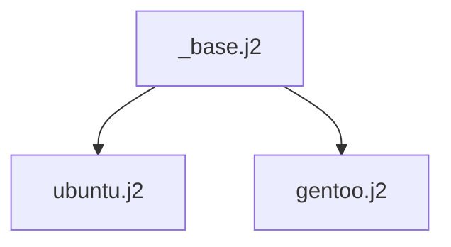

# linux-desktop-vm — Architecture & Fleet Guide

This document covers the internal architecture, build phases, pre-flight
gates, timing data, and fleet-building orchestration. It's intended for
developers and maintainers — end users should start with [README.md](../README.md).

## Template hierarchy



Each concrete template is self-contained. `ubuntu.j2` owns the full APT
stack (inlined from the retired `_apt_family.j2`).

## Latest-Version Discovery

Each distro's "latest" is resolved at runtime, not hardcoded:

| Distro | Source of truth |
|--------|----------------|
| Ubuntu LTS | Canonical cloud-image metadata; highest supported LTS wins |
| Gentoo | `distfiles.gentoo.org` autobuilds index (latest `di-<arch>-cloudinit-*.qcow2`) |

When a new release ships (Ubuntu 28.04 LTS, etc.), the script
picks it up automatically with no code change.

## How It Works (internal flow)

1. Detect host (macOS on arm64) and locate QEMU tools.
2. Auto-install `qemu-img` if missing (via Homebrew).
3. Auto-install `pycdlib`, `certifi`, and `jinja2` pip packages. Inside a venv this installs directly into the venv; outside, it uses `--user` scope with a `--break-system-packages` fallback for PEP 668 (externally-managed) environments.
4. Resolve the chosen distro's latest cloud image URL + hash.
5. Download + verify the cloud image (SHA256 or SHA512 depending on distro).
6. Resize qcow2 to target disk size using `qemu-img resize`.
7. Render cloud-init templates with hostname / username / password / TZ.
8. Build a NoCloud seed ISO (volume label `cidata`) using `pycdlib`.
9. Render the VM definition file (shell launcher script).
10. Start the VM via the shell launcher script (QEMU on macOS with HVF).

Inside the guest, cloud-init then:
- Sets hostname, creates the user with sudo, sets the password
- Updates packages and installs the desktop (distro-specific install path)
- Sets `graphical.target` as default, enables the display manager
- Reboots into the GDM login screen (Wayland session)

## Code Organization

The orchestration lives in `linux_vm/` (see [AGENTS.md](../AGENTS.md)'s repository layout).
`_build_one_vm()` in `linux_vm/orchestrate.py` delegates to
single-responsibility helpers:

1. **`_find_or_install_qemu_img(host)`** - Locate or install qemu-img
2. **`_install_if_missing(installer_func, package_name)`** - Centralized prerequisite dependency handling (the `ensure_pycdlib` / `ensure_certifi` / `ensure_jinja2` installers catch their own ImportErrors)
3. **`_build_vm_config(args, host, defaults, resolved)`** - Build and configure VM configuration with distro-specific VM name logic (uses the already-resolved distro object; resolve happens once before config)
4. **`_ensure_image(resolved, qcow2, cache_dir, distro)`** - Download, hash verification, and cache management. The shared-cache path (`download_to_cache`) verifies the hash once on the cached file; a hardlink into the target dir shares that inode so it is not re-hashed, while a real cross-volume copy gets its own verification. A stale target image is detected by the reuse-path hash check and re-downloaded.

`_build_one_vm()` runs these in four phases: QEMU detection, host-side
preparation, image resolution/caching, and launch (template rendering +
VM startup).

## Pre-flight gates

The fleet orchestrator runs six cheap-to-expensive gates that catch
failures fast instead of discovering a typo in a 6-hour fleet run. Gates
0, 0b, 0c and 0d are the seconds-scale static checks; 1 through 3 grow
from minutes to a quarter of an hour.

### Gate 0 — Lint (~3 sec)

`python scripts/lint-templates.py` renders every (distro ×
mode) combo via jinja2, validates the YAML, and asserts every render
contains the `VERIFY-OK` / `SIMULATE-OK` markers. Currently 16/16 pass
(2 distros × 2 arches × 4 checks: real, simulate, package parity, and
password quoting).

The per-render checks are:

- **Render + YAML** — jinja2 render, `yaml.safe_load`, marker presence.
- **Shell syntax** — `sh -n` and `bash -n` on every `runcmd`/`bootcmd`
  entry that hands a script to a shell. Matched via `entry[1] == "-c"`
  historically, which silently skipped `bash -lc` entries; the checker
  now recognises a known shell binary plus any of `-c`/`-lc`/`-cl`/`-ic`
  as the flag, so both sides of the check agree on what a shell entry is.
- **Simulate/real parity** — the packages installed by the real install
  script must match the simulate-mode package list, or the dry-run is
  validating something the real build never installs.
- **Password quoting** — re-renders each template with hostile password
  shapes (`1234`, `yes`, `0000`, `true`, `it's-a-quote`, `say "hi"`,
  `a:b`) and walks every scalar in the resulting cloud-config, failing
  when a value contains the password but did not survive as `str`. This
  is the gate that catches an unquoted `password: {{ PASSWORD }}`, which
  renders `1234` as an int and `yes` as a bool and makes cloud-init
  reject the whole user-data. It fails on all four (distro × arch) combos
  if `_base.j2` ever loses its `'{{ PASSWORD | replace("'", "''") }}'`.

The fleet runner executes this itself as its first gate (hard-fail:
non-zero lint aborts the fleet before any image is downloaded or VM
booted, exit code 5). `--no-lint` skips it, mirroring the other gates.

### Gate 0b — Audit (~1 sec cold; previously quoted ~10 sec, measured 0-1 s on the latest runs)

`python scripts/audit-packages.py` renders both templates, extracts
each distro's explicit package set, and applies the `REQUIRED`
verdict: every required (category, distro) pair — the curated
desktop/app set from README's "Apps preinstalled on every VM" — must
be present in that distro's package list. Catches a package silently
dropped from one template that lint (render-only) and simulate
(resolver-only) both pass, and that the verify-block would otherwise
only report hours into a real build.

The fleet runner executes this as its second gate (hard-fail, exit
code 7). `--no-audit` skips it. Failures print `[FAIL] <distro>:
missing required category ...`; updating expectations means editing
`REQUIRED` in the audit script alongside the template change.

### Gate 0c — Pylint (~7 sec over the whole tree)

`python scripts/lint-python.py` runs pylint over every tracked `*.py`
(`linux_vm/`, `scripts/`, `tests/`, `setup_vm.py`) with `.pylintrc`,
and fails on any message pylint reports (`PYLINT-FAIL`, exit 1).

The fleet runner executes this as its third gate (hard-fail, exit
code 8). `--no-pylint` skips it. A missing pylint is a setup error
(exit 2) rather than a silent pass — the script resolves it from the
current interpreter, then `PATH`, then `<repo>/.venv`.

Scope differs by caller, deliberately:

- **Fleet = whole tree.** A multi-hour build exercises every checked-in
  file, not just the last diff, so all of it has to be clean.
- **CI on `push` = changed files.** `.github/workflows/pylint.yml` calls
  the same script with `--changed-since <ref>`, where `<ref>` is the
  push's `before` sha — so the files that push changed (`before..HEAD`,
  one run covers a multi-commit push) and nothing else. The diff is
  ref → working tree: it includes untracked new files and excludes
  deletions. When the ref will not resolve (root commit, force-push, the
  all-zero `before` of a branch's first push) it falls back to the full
  tree and says so, so CI can never report success having checked
  nothing. An empty change set (a docs-only push) passes with
  `PYLINT-OK: no Python files in scope`.
- **CI on a manual `workflow_dispatch` = whole tree.** The step runs the
  script with **no arguments**, because a hand-triggered run is an
  explicit request to validate everything, not to re-check a diff.

### Gate 0d — Unit tests (~8 sec)

`python scripts/run-tests.py` runs `unittest discover` over `tests/`
(129 tests as of the current tree: `test_logic.py` for template/logic
behaviour, `test_fleet.py` for fleet control flow). A missing `tests/`
directory or a discovery that finds zero tests is exit 2, never a pass;
failures are exit 1; success prints `TESTS-OK: N tests passed`.

The fleet runner executes this as its fourth gate (hard-fail, exit
code 9). `--no-tests` skips it.

These tests are the only coverage of `linux_vm/fleet/` — the code whose
bugs are most expensive, because a wrong verdict there is invisible until
hours into an unattended overnight run. They cover the cleanup path that
prevents a leaked QEMU from starving the host, the process-group teardown
that makes a phase-1 timeout stop the VM it launched, the
cloud-init status → exit-code ladder, the marker grep exit-code handling
(Ubuntu's grep exits 2 on a match because only Gentoo writes
`verify-marker.log`), and CLI flag validation.

CI runs the **whole** suite on every event, with no `--changed-since`
mode: the assertions are about build-verdict behaviour, so any subset can
pass while the thing under test regressed.

### Gate 1 — Smoke test (~2-3 min warm; latest cold-cache run 1.9 min, the warm re-run inside the same fleet 0.3 min, earlier cold runs 5-10 min)

`python scripts/smoke-test-cli.py` exercises the orchestrator ↔
setup_vm.py CLI contract by running `--prefetch` and `--simulate`
end-to-end for ubuntu-lts. The shim delegates to
`linux_vm.orchestrate.main()`; catches AttributeError-class bugs where
the orchestrator passes an arg the CLI doesn't know about.

Each of the three CLI runs is followed by an assertion that it left **no
`qemu-system` process** behind (scoped to the smoke test's scratch target
dir, so an operator's own running VM does not fail the gate). The gate's
docstring claimed this from the start but only checked the exit code; a
leaked VM is exactly the failure mode that starves the host and breaks
every later build, and exit 0 says nothing about it. It also checks the
fleet package wiring (`REPO` resolves to the repo root, `linux_vm.fleet`
imports) and the fleet entry point's rc=2 on an unknown flag.

### Gate 2 — Prefetch (latest cold-cache run: gentoo 2.3 min + ubuntu 0.0 min pre-warmed by the smoke test; previous cold-cache run gentoo 2.6 min + ubuntu 0.0 min; ~10-15 min on a slow network, ~0-2 min warm)

`build-fleet-sequential.py --prefetch-only` warms the shared image cache
at `~/VMs/cache/<distro>/` before any VM build starts. Hard-fail: if
any URL is dead, the fleet aborts immediately. Cache survives across
runs; subsequent runs are SHA-verification only.

### Gate 3 — Simulate (~10-26 min for all 2, ~1.7-1.8 min ubuntu-lts, ~8-24 min gentoo; latest run: 1.8 min ubuntu-lts + 18.4 min gentoo = 20.3 min total, 2/2 PASS, 0.38 h for prefetch + simulate (2.3 min + 20.3 min) on a cold cache, run as a standalone `--simulate-only` pre-pass before a full `--no-simulate` build; previous cold pass 24.6 min total with gentoo 18.3 min; before that 25.6 min total with gentoo 23.8 min; an earlier cold pass 20.3 min total with gentoo 18.4 min)

`build-fleet-sequential.py --simulate-only` boots a short-lived
**simulate-mode VM** per distro (no real install): `setup_vm.py
--simulate` renders the user-data with `simulate_only=True`, and the
per-distro `` runs the package resolver
against the full target list — `apt-get install --simulate` on Ubuntu,
`emerge --pretend` (binhost dry-run) on Gentoo. SIMULATE-OK /
SIMULATE-FAIL markers decide the verdict.
Hard-fail: per-distro PASS/FAIL/ERROR table printed at the end.

## Per-VM build phases

Once the gates pass, each VM goes through:

- **Phase 1 — host-side build** (~2-10 min): download cloud image
  (from cache), resize to target disk size, generate seed ISO, launch VM.
- **Phase 2 — guest cloud-init install** (~15-210 min measured;
  host-CPU contention can exceed the 60-min wait timeout): cloud-init
  runs bootcmd + packages + runcmd + verify-block; orchestrator polls
  via SSH every 5 min until `done` / `degraded done` or `error - done`.
  **Ubuntu used to land on `degraded done` rather than `done`**: a single
  benign `lock_passwd` warning (password supplied via `chpasswd:` rather
  than on the user entry) was the only WARN-level record, and any WARN
  makes cloud-init report degraded. The template now sets
  `plain_text_passwd` on the user entry itself, so builds reach a clean
  `done`. Independently of that, the orchestrator snapshots the guest's
  `status.json` on every wait exit (see *Watching progress*) and emits a
  `WARN:` to the master log whenever `errors`/`recoverable_errors` are
  non-empty — a genuinely degraded build can no longer pass silently.
  Success still requires the `VERIFY-OK` marker. See the corresponding
  entry in [AGENTS.md](../AGENTS.md)'s "Known battle scars" for the full
  mechanism.
- **Verify-block** (~5-10 sec, last runcmd entry): asserts every
  README-promised component is installed; emits `VERIFY-OK` on success.
  Orchestrator only treats a build as success if this marker is present.

## Timing

### Phase 1 — host-side build (~1-5 min, measured on macOS host)

Representative numbers from a warm-cache fleet build on macOS host
with an SSD:

| Distro | QEMU (min) | Cloud image (~MB) | Notes |
|--------|:---------:|:-----------------:|-------|
| ubuntu-lts | 0.2-0.7 | ~700 | |
| gentoo | ~2 | ~500 | Stage3 cloud image + Portage tree sync |

Phase 1 step breakdown (averaged):

| Step | QEMU |
|------|------|
| Resolve (network) | <2 s |
| Download (~300 MB - 2 GB) | 30 s - 4 min |
| Resize disk | ~5 s (qemu-img resize) |
| Build seed ISO + definition | <5 s |

### Phase 2 — guest cloud-init install (15-53 min Ubuntu, 42-231 min Gentoo)

Timings below assume an **idle host**. Under host CPU contention (app +
agent actively polling a 4-core Mac while the VM installs) they balloon
badly: ubuntu-lts exceeded the
60-min wait timeout entirely (see the "Host CPU starvation" battle scar in [AGENTS.md](../AGENTS.md)).

The Phase 2 timing has improved dramatically after fixing orphaned SSH child processes. The fix prevents the process-hanging issue that caused times to exceed 279+ minutes.

The latest all-2 cold-cache run (ubuntu-lts 49.2 min total / 47.7 min cloud-init, gentoo 174.4 min total / 170.6 min cloud-init) sits inside the bands above; Gentoo still dominates the spread because its slow end is arm64 source builds landing cold (gcc `cc1` compilation phases plus a Go snapd build), not a defect.

### Phase 2 wait bounds (per distro)

Two independent clocks bound phase 2, and for Gentoo they are a **coupled pair** that must stay ordered:

| Clock | Where | ubuntu-lts | gentoo |
|---|---|---|---|
| Guest install-wait loop | `templates/gentoo.j2` runcmd `for i in $(seq 1 600) … sleep 30` — waits for `gentoo-install.service` to write `/var/lib/gentoo-install-done` | n/a (apt finishes inside cloud-init) | **300 min (5 h)** |
| Fleet cloud-init cap | `linux_vm/config.py` `DISTRO_DEFAULTS[…]["cloud_init_wait_timeout_sec"]`, consumed at `linux_vm/fleet/orchestrator.py:85` | 3600 s = 60 min | **21600 s = 360 min (6 h)** |

The guest loop starts later (it begins when `runcmd` reaches the wait entry) and stops earlier (at the done marker), while the fleet cap starts at boot and stops at VERIFY-OK — after the loop plus GDM, dconf, app platforms, snaps and the verify block. So the two clocks are **not interchangeable and must not be equal**: an equal pair makes the fleet deadline land strictly before the guest's loop can expire, writes the failure verdict and shuts the VM down while the guest is still legitimately emerging, and reports a healthy build as FAILED. Gentoo's loop is therefore 300 min with a 60-min margin to the 360-min cap (~1.3× and ~1.55× the worst cloud-init ever measured at 231.7 min). Gentoo's guest loop only stays that small because `/etc/portage/package.mask/webkit-binpkg` pins `net-libs/webkit-gtk` at `>2.52.6-r600` and pulls both slots (4.1 via geary, 6 via epiphany) from the arm64 binhost; that pin is the only thing standing between 300 min and the ~9.4 h two-slot source build that once forced the loop to 1680 × 30 s (14 h) after the original 5 h bound fired first. Lift the pin and this pair goes back up with it. Locked by `tests/test_logic.py::TestGentooWaitBoundPair`.

Measured across verified re-runs (Apple Silicon MacBook Pro (host 18 cores / 48 GB; VM 8 vCPU / 24 GB), warm cache):

| Distro | Total (min) | Notes |
|--------|:---------:|-------|
| ubuntu-lts | 16.4 - 54.3 | apt cloud-init 15.1-52.9 min (phase-2), shutdown ~5 s-1 min; latest build 49.2 min total / 47.7 min cloud-init (cold-cache all-2 fleet run launched as a standalone `--simulate-only` pre-pass that exited `rc=0` followed by a full `--no-simulate` build, VERIFY-OK, `extended_status: done`, 0 errors, 0 recoverable errors, clean shutdown); previous build 49.4 min total / 47.7 min cloud-init (cold-cache all-2 fleet, VERIFY-OK, 0 errors, 0 recoverable errors); before that 21.9 min total / 20.4 min cloud-init (ubuntu-lts-only, VERIFY-OK); earlier 49.3 min total / 47.7 min cloud-init (ubuntu-lts-only), 21.8 min total / 20.5 min cloud-init (ubuntu-lts-only), 49.2 min total / 47.8 min cloud-init (cold-cache all-2 fleet), 16.5 min total / 15.1 min cloud-init, 38.2 min total / 36.8 min cloud-init; fastest measured 16.4 min total / 15.1 min cloud-init |
| gentoo | 45.5 - 232.5 | cloud-init 42.0-231.9 min (gentoo-install.service); spread from binhost warmth + guest-DNS flap retries + host load; recent runs include a ~10 min in-guest build of the miles.buckton mesa fork; latest run (cold-cache all-2 fleet) 174.4 min total / 170.6 min cloud-init (VERIFY-OK confirmed by the fleet's `_check_success_marker`, `extended_status: done`, 0 errors, 0 recoverable errors, clean shutdown — a brief openssh-merge SSH blip self-healed via `heal_ssh` and an early guest-DNS flap for `distfiles.gentoo.org` was non-fatal); the previous run (cold-cache all-2 fleet) was 224.2 min total / 220.2 min cloud-init (VERIFY-OK, `extended_status: done`, 0 errors, 0 recoverable errors, clean shutdown ~11 s — slow end was ~1 h of arm64 source builds: emerge + gcc `cc1` + a Go snapd build); before that (cold-cache all-2 fleet, rerun after the verify-atom fix) 232.5 min total / 228.7 min cloud-init (VERIFY-OK, `extended_status: done`, 0 recoverable errors, clean shutdown ~10 s), whose first attempt FAILED at the VERIFY block after 235.6 min total / 231.7 min cloud-init on a stale verify atom (`gnome-extra/gnome-sound-recorder` vs the real `media-sound/gnome-sound-recorder`) while guest cloud-init itself stayed clean (status done, errors=[], recoverable={}); earlier successful runs 67.0 min total / 63.3 min cloud-init (clean run with `heal_ssh`) and a gentoo-only rerun 167.8 min total / 164.1 min cloud-init (30/30 SSH probes rc=0 after the `heal_ssh` fix — ~65 min of PKGS-loop source builds dominated) |

### Total wall time = phase 1 + phase 2 + shutdown

Measured from full-fleet re-runs (Apple Silicon MacBook Pro (host 18 cores / 48 GB; VM 8 vCPU / 24 GB), warm cache):

| Distro | Total (min) |
|--------|:---------:|
| ubuntu-lts | 16.4 - 54.3 |
| gentoo | 45.5 - 232.5 |

**Key Improvement Summary:**
- **SSH Child Process Fix**: After fixing orphaned SSH child processes that were hanging indefinitely, Phase 2 times dropped from 279+ minutes to ~15-53 min (Ubuntu) / ~42-210 min (Gentoo)
- **Success Rate**: Previously unpredictable hangs, now all distros complete in predictable timeframes
  - **Fleet Total**: Verified all-2 fleet runs measured **1.71-5.16 h wall** on the Apple Silicon MacBook Pro (latest: 3.74 h — cold cache, every gate green, both VMs VERIFY-OK): the latest run (cold cache — `~/VMs` wiped, images re-downloaded; launched as a standalone `--simulate-only` pre-pass that exited `rc=0` and then a full build with `--no-simulate` so the just-passed simulate gate was not repeated; every gate green: lint 16/16, audit 108/108, pylint 10.00/10, 129 tests, smoke, prefetch ubuntu 0.0 min + gentoo 2.3 min, simulate 2/2 PASS in 20.3 min [ubuntu 1.8 min + gentoo 18.4 min]) + ubuntu-lts 49.2 min total / 47.7 min cloud-init (VERIFY-OK, 0 errors, 0 recoverable errors, clean shutdown) + gentoo 174.4 min total / 170.6 min cloud-init (VERIFY-OK, 0 errors, 0 recoverable errors, clean shutdown) = `DONE in 3.74h`; the previous run (cold cache; every gate green: lint 16/16, audit 108/108, pylint 10.00/10, 115 tests, smoke, prefetch ubuntu 0.1 min + gentoo 2.6 min, simulate 2/2 PASS in 20.3 min [ubuntu 1.8 min + gentoo 18.4 min]) + ubuntu-lts 49.4 min total / 47.7 min cloud-init (VERIFY-OK, 0 errors, 0 recoverable errors, clean shutdown) + gentoo 224.2 min total / 220.2 min cloud-init (VERIFY-OK, 0 errors, 0 recoverable errors, clean shutdown) = `DONE in 4.99h`; the run before that (cold cache; every gate green: lint 16/16, audit 109/109, pylint 10.00/10, 104 tests, smoke, prefetch cold, simulate 2/2 PASS in 24.6 min [ubuntu 1.8 min + gentoo 18.3 min]) + ubuntu-lts 49.2 min total / 47.8 min cloud-init (VERIFY-OK, 0 errors, 0 recoverable errors, clean shutdown) + gentoo 232.5 min total / 228.7 min cloud-init (VERIFY-OK, 0 recoverable errors, clean shutdown) via a `--start-from gentoo` rerun `DONE in 4.29h` — gentoo's first attempt in that run VERIFY-FAILed at its verify block after 235.6 min total / 231.7 min cloud-init on a stale `gnome-extra/gnome-sound-recorder` atom while the guest cloud-init itself stayed clean (status done, errors=[], recoverable_errors={}); a previous run (cold cache; all gates green, simulate 2/2 PASS in 25.6 min [ubuntu 1.8 min + gentoo 23.8 min]) reached `DONE in 5.16h` from launch + ubuntu-lts 43.8 min total / 42.3 min cloud-init + gentoo 235.5 min total / 231.4 min cloud-init (both VERIFY-OK, 0 errors, 0 recoverable errors); before that a cold run reached `DONE in 1.71h` from launch with all 5 gates passed (lint 12/12, audit 101/101, smoke, prefetch 1.9 min, simulate 15.0 min [ubuntu 1.8 min + gentoo 13.2 min]) + ubuntu-lts 16.5 min total / 15.1 min cloud-init + gentoo 67.0 min total / 63.3 min cloud-init (both VERIFY-OK, 0 errors, 0 recoverable errors, clean shutdowns); a previous warm-binhost run (ubuntu-lts 37.9 min + gentoo 45.5 min = ~83 min guest provisioning + shutdown + prefetch + ~19 min simulate gate) at 1.72 h; an earlier cold-cache run at **2.27 h** from launch (all 5 gates 29.5 min + ubuntu-lts 38.2 min + gentoo ~65 min cloud-init); a colder/slower run stretches to **4.56 h** (ubuntu-lts 49.0 min + gentoo 214.2 min + ~10 min simulate gate + prefetch). The fastest measured ubuntu build reached its first SUCCESS in **18.7 min** (gates incl. an ubuntu-only simulate at 1.7 min + prefetch + ubuntu-lts 16.4 min total / 15.1 min cloud-init, VERIFY-OK); that single-distro gate set is cheaper than the all-2 one, which produced the fastest all-gates result of **31.5 min** (prefetch 0.0 min + simulate 15.0 min [ubuntu 1.8 min + gentoo 13.2 min] + ubuntu-lts 16.5 min total / 15.1 min cloud-init). A previous **simulate-only** pass over both distros at **15.0 min** (0.25 h; 2/2 PASS — ubuntu 1.8 min + gentoo 13.2 min), previous such pass at **0.46 h** on a cold cache (prefetch ubuntu-lts 0.0 min + gentoo 1.9 min, then ubuntu 1.8 min + gentoo 23.6 min), an earlier pass at **0.34 h** on a warm cache (prefetch ubuntu-lts 0.0 min + gentoo 0.0 min, then ubuntu 1.8 min + gentoo 18.3 min), and the latest **ubuntu-lts full build** at **49.2 min VM total / 47.7 min cloud-init, VERIFY-OK** (cold-cache all-2 fleet run, 0 errors, 0 recoverable errors, clean shutdown), previous at 21.9 min VM total / 20.4 min cloud-init (ubuntu-lts-only, VERIFY-OK), before that 49.3 min VM total / 47.7 min cloud-init (ubuntu-lts-only, VERIFY-OK), before that 21.8 min VM total / 20.5 min cloud-init (ubuntu-lts-only, VERIFY-OK), before that 49.4 min VM total / 47.7 min cloud-init (cold-cache all-2 fleet), earlier 49.2 min VM total / 47.8 min cloud-init, previous cold run at **43.8 min VM total / 42.3 min cloud-init, VERIFY-OK**, before that **16.5 min VM total / 15.1 min cloud-init, VERIFY-OK** (first SUCCESS 35.5 min after launch of cold all-2 fleet), earlier **1.13 h wall** run (all 5 gates 29.5 min + phase-1 0.2 min + cloud-init 36.8 min → 38.2 min VM total, VERIFY-OK, `extended_status: done`, 0 recoverable errors, first SUCCESS 67.8 min after launch), before that **~0.91 h wall** (gates + prefetch + phase-1 0.2 min + cloud-init 52.9 min → 54.3 min VM total, VERIFY-OK, `extended_status: done`, 0 recoverable errors, shutdown ~10 s), and the latest **gentoo full build** at **174.4 min VM total / 170.6 min cloud-init, VERIFY-OK** (cold-cache all-2 run, 0 errors, 0 recoverable errors, clean shutdown); the previous gentoo full build was **224.2 min VM total / 220.2 min cloud-init, VERIFY-OK** (cold-cache all-2 run, 0 errors, 0 recoverable errors, clean shutdown ~11 s; slow end was ~1 h of arm64 source builds); before that **232.5 min VM total / 228.7 min cloud-init, VERIFY-OK** (`--start-from gentoo` rerun after the stale-verify-atom fix, 0 recoverable errors, clean shutdown; its first attempt had VERIFY-FAILed at the sound-recorder gate after 235.6 min VM total / 231.7 min cloud-init with a clean guest cloud-init), before that **67.0 min VM total / 63.3 min cloud-init, VERIFY-OK** (clean run with `heal_ssh`, full VERIFY-OK, 0 recoverable errors), earlier gentoo-only rerun at **2.80 h wall** (gates lint+audit+smoke+prefetch ~23 s + prefetch + phase-1 0.2 min + cloud-init 164.1 min → 167.8 min VM total, VERIFY-OK, `extended_status: done`, 0 recoverable errors, shutdown ~10 s). The fastest measured ubuntu build remains 16.4 min VM total / 15.1 min cloud-init.

The Phase 2 timing shows the impact of the SSH child process fix — Ubuntu now completes in ~15-53 min and Gentoo in ~42-231 min instead of hanging for 279+ minutes.

The gate counts quoted in the run records above (lint 12/12, "all 5 gates") describe the gate set as it stood when those runs were measured. Gate 0d (unit tests) was added afterwards, so a fresh run reports 16/16 on lint and one more gate in the pre-flight block; the per-VM and gate timings themselves are unaffected.


### Day-2 patterns

All day-2 installs (previously handled by `install-day2-packages.service`)
have been removed from the stack. No heavy post-boot downloads occur;
everything installs during cloud-init's runcmd phase.

## Fleet building

`build-fleet-sequential.py` builds all 2 supported distros for QEMU
in sequence. It runs one VM at a time so memory stays bounded.

Each VM defaults to **half the host's physical CPU cores (clamped 2-8) /
half the host's RAM (clamped 8-32 GB) / 80 GB disk** — e.g. 8 vCPU on an 18-core host, 2 vCPU on a
4-core host. `recommended_vcpus()` in `host.py` reads `sysctl hw.physicalcpu`
(physical, not logical: hyperthreading would otherwise
double-count). Halving leaves the other half of the cores for the host and
other apps: a full-core VM on a small contended host starves the guest
(kernel soft lockups → cloud-init stalls → wait timeouts) and throttles the
orchestrator's own SSH probes (see [AGENTS.md](../AGENTS.md) "Known battle scars"). For
fastest, most reliable runs, keep the machine otherwise idle during a
fleet build.

```bash
python build-fleet-sequential.py

# Or build a specific subset, in the order you want:
python build-fleet-sequential.py --distros ubuntu-lts,gentoo
# Order is honoured: ubuntu-lts -> gentoo -> ...
```

Per-VM logs:
- `~/VMs/<distro>.build.log` — phase 1
- `~/VMs/<distro>.wait.log` — phase 2 (cloud-init monitor)
- `~/VMs/build-fleet.log` — master status

Flags:
- `--distros d1,d2,...`: scope to specific distros (default: all)
- `--prefetch-only`: run Gate 2 only (warm cache; Gates 0 lint / 0b audit / 0c pylint / 0d tests / 1 smoke still run first)
- `--simulate-only`: run Gate 3 only (simulate-mode VM package-resolver check; earlier gates still run first)
- `--no-lint` / `--no-audit` / `--no-pylint` / `--no-tests` / `--no-smoke` / `--no-prefetch` / `--no-simulate`: skip individual gates
- `--no-preflight`: skip the preflight orphan-VM cleanup (only kills leftover qemu-system processes under `~/VMs`)

Conflicting flags are rejected up front with exit code 2, before any
gate runs: `--simulate-only --no-simulate` and `--prefetch-only
--no-prefetch`. Previously `--simulate-only` was honoured only inside the
`if not skip_simulate:` block, so that pair skipped the simulate phase,
never returned, and fell through into a full multi-hour real build loop —
the opposite of what was asked for.

Preflight cleanup runs **before** the prefetch and simulate gates, not
after them. It force-kills leftover `qemu-system` processes under
`~/VMs`; running it after the ~15 min simulate gate meant an orphan from
a previous run kept burning host CPU through the gate, which is exactly
the starvation condition that soft-locks guests. `--prefetch-only` and
`--simulate-only` skip it: neither mode builds a VM, so neither should
kill one the operator has running.

## Watching progress

The script captures the guest's serial console (ttyS0) to
`<target_dir>/console.log`. On every cloud-init wait exit the fleet
orchestrator also pulls the guest's `/var/lib/cloud/data/status.json`
to `<target_dir>/cloud-init-status.json` (simulate runs land it next to
the per-distro target dir too) and appends an `errors=`/`recoverable=`
summary to the wait log. That file is the only surviving record of the
build boot's `recoverable_errors` — `status.json` is rewritten on every
guest boot, so re-booting the VM to inspect a finished build destroys
the evidence. The `monitor` subcommand has two modes:

**Phase-bar mode** (default):
```bash
python setup_vm.py monitor ~/VMs/ubuntu-lts
python setup_vm.py monitor ~/VMs/ubuntu-lts --once  # snapshot, exit
```

Live progress bar shows 5 phases with ~30-sec SSH queries for the
current cloud-init module name.

**Live-tail mode** (`--tail`):
```bash
python setup_vm.py monitor ~/VMs/ubuntu-lts --tail
```

Streams every package-manager line via SSH. Requires `paramiko`
(`pip install paramiko`) and the per-VM `ssh_key` file.